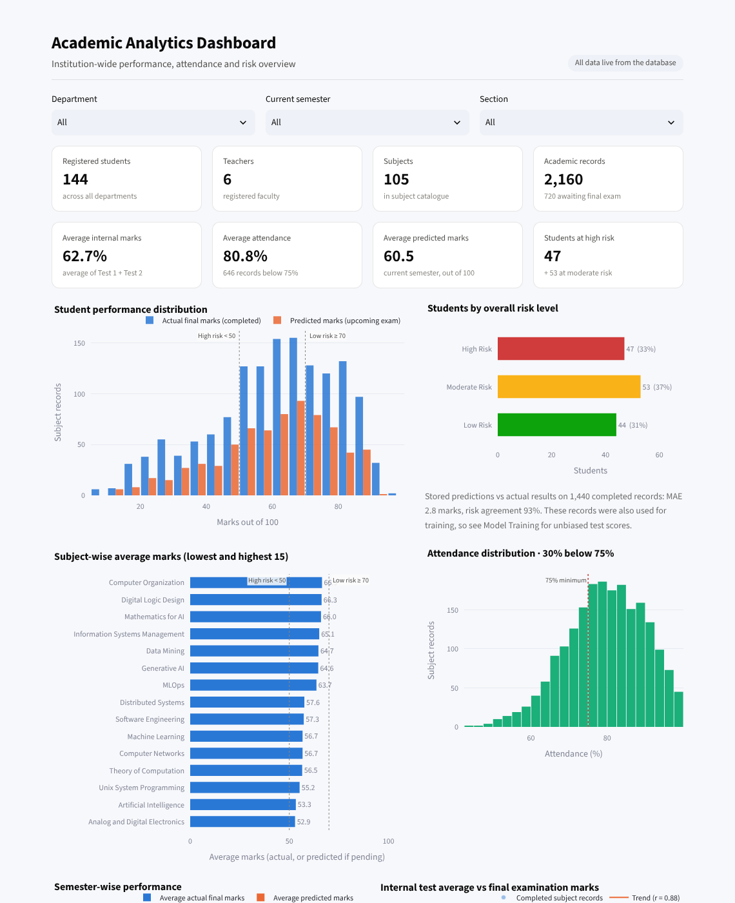
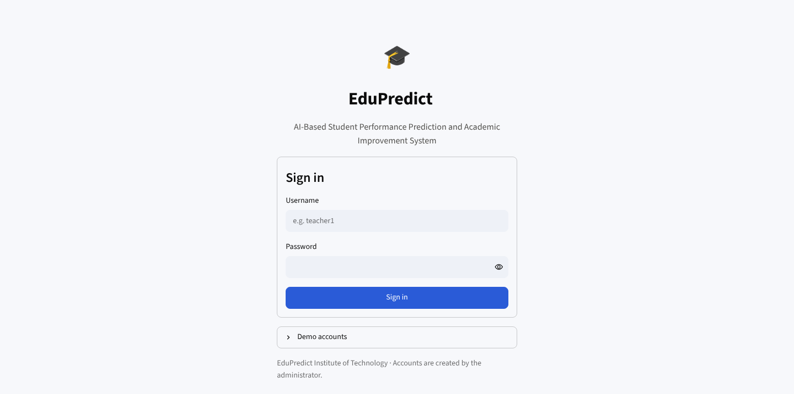
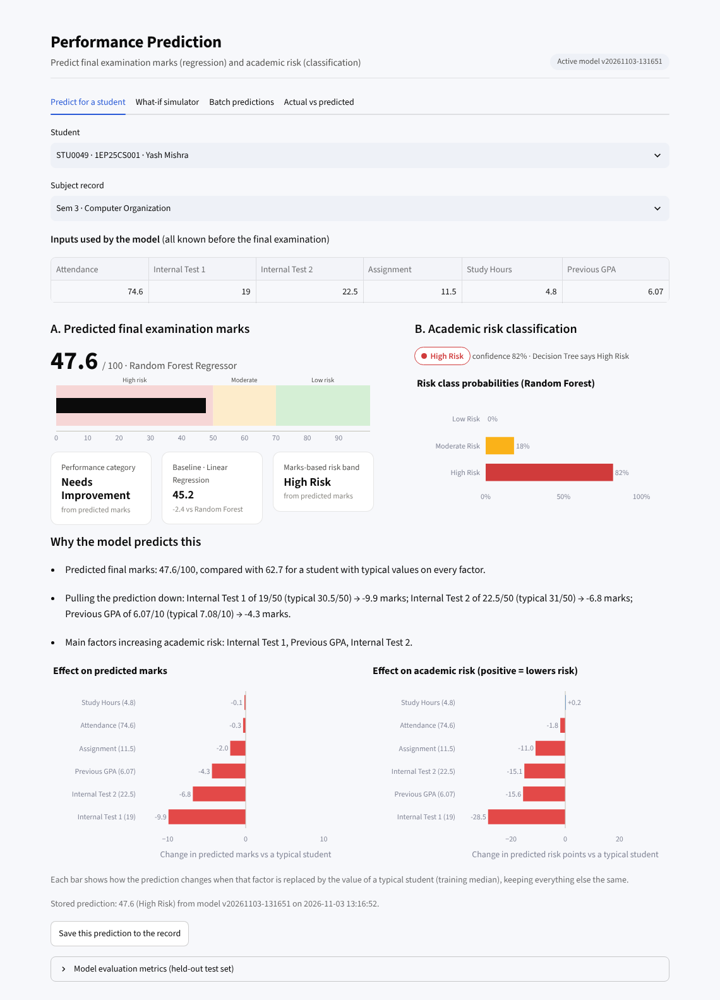
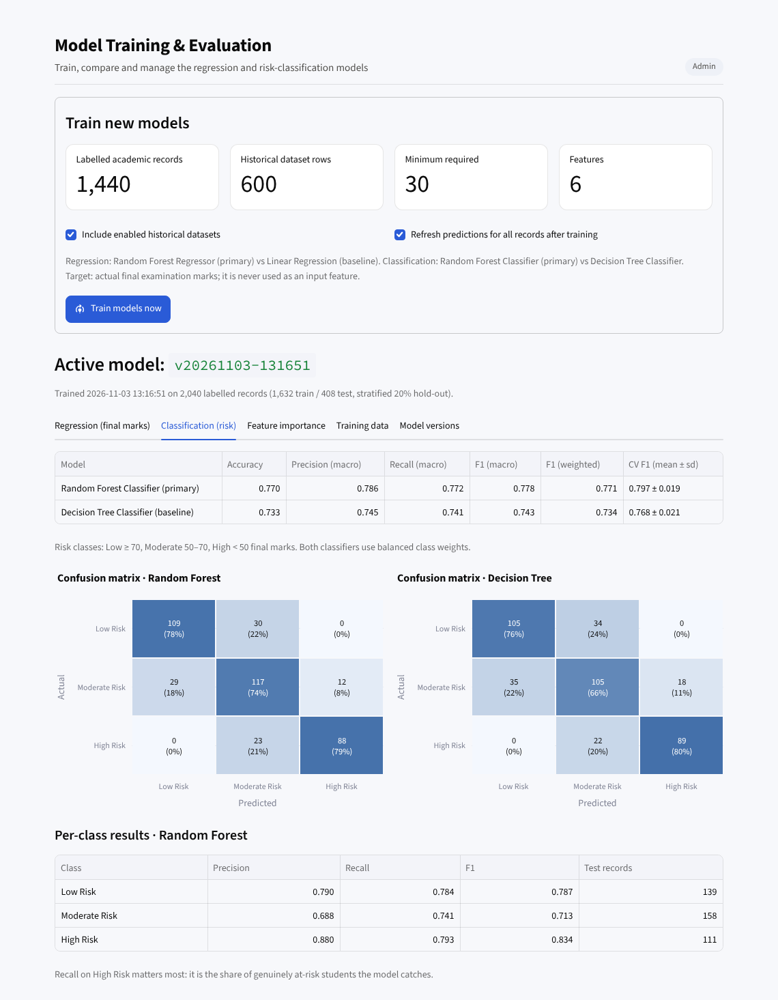
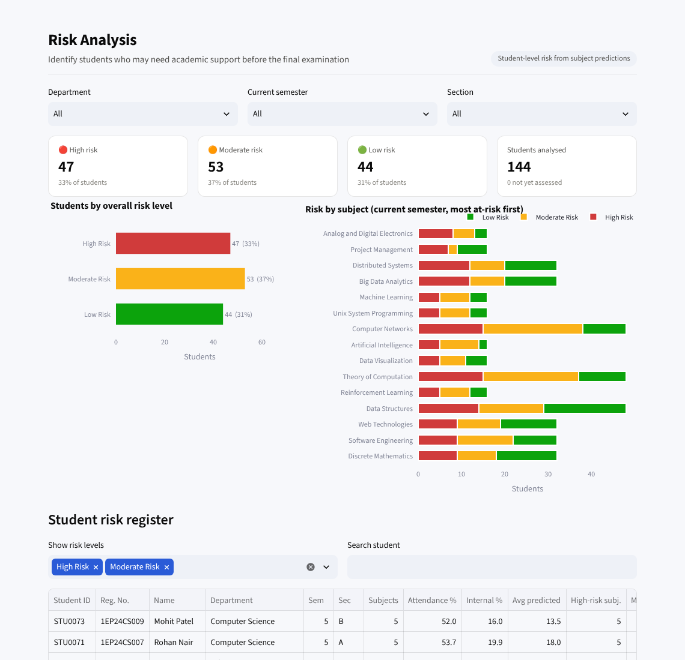
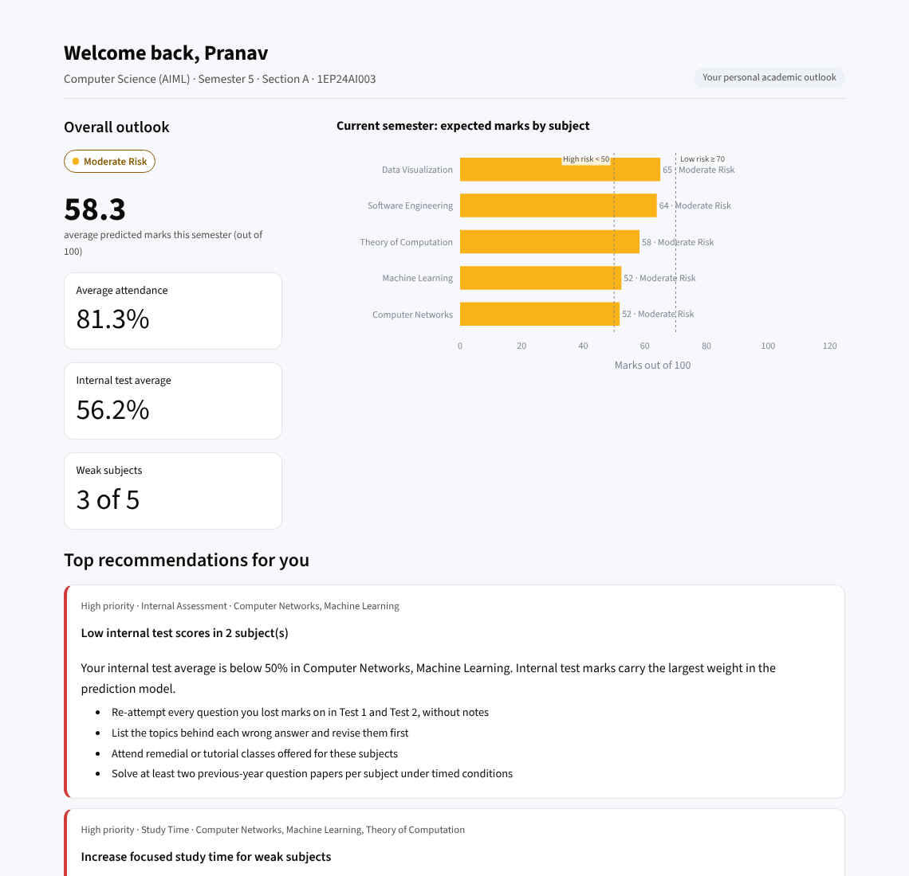
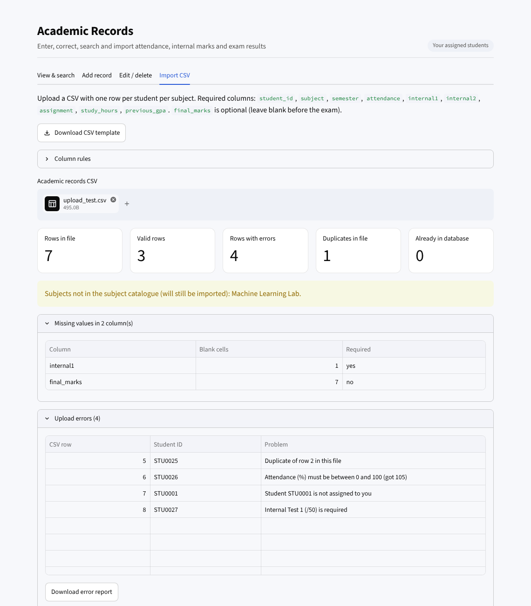

# EduPredict – AI-Based Student Performance Prediction and Academic Improvement System

EduPredict is a complete Streamlit web application that predicts students' final examination marks, classifies their academic risk, finds weak subjects, generates personalised study recommendations and produces PDF reports for students and classes.

It is built as a BE Computer Science (AIML) mini-project and shows a full, practical machine-learning workflow: data management, validation, training, evaluation, model storage, prediction, explanation and reporting. It is an **academic decision-support tool**. It does not replace teachers.



---

## 1. Quick start

**Requirements:** Python 3.11 or newer. No paid API and no cloud service is needed; everything runs locally.

```bash
# 1. Create and activate a virtual environment
python -m venv .venv
# Windows:  .venv\Scripts\activate
# macOS/Linux:  source .venv/bin/activate

# 2. Install dependencies
pip install -r requirements.txt

# 3. Run the app
streamlit run app.py
```

The app opens at <http://localhost:8501>.

**First run:** the app creates the SQLite database, generates the synthetic dataset, trains the four ML models and predicts every record. This takes about 30 seconds and only happens once.

### Demo credentials

| Role | Username | Password | What you will see |
|---|---|---|---|
| Admin | `admin` | `Admin@123` | Everything: all students, users, datasets, model training |
| Teacher | `teacher1` | `Teacher@123` | Dr. Ananya Sharma – AIML semester 5 A, 5 B and 7 A (24 students) |
| Teacher | `teacher2` … `teacher6` | `Teacher@123` | Other departments and classes |
| Student | `student1` | `Student@123` | A **moderate-risk** student in teacher1's classes |
| Student | `student2` | `Student@123` | A **high-risk** student |
| Student | `student3` | `Student@123` | A **low-risk** student |

The login page also lists these accounts in a "Demo accounts" panel. Change or remove them before any real use.

### Useful commands

```bash
python scripts/reset_database.py --yes     # delete everything and re-create the demo data
python scripts/train_models.py             # retrain the models from the command line
python scripts/generate_sample_data.py     # re-write the sample CSV files in data/
python -m pytest                           # run the 75 automated tests
```

The `.vscode/launch.json` file includes "Run" and "Debug" configurations for VS Code.

### Publish a free public demo link (Streamlit Community Cloud)

Streamlit Community Cloud hosts Streamlit apps for free and gives you a permanent link such as `https://edupredict-demo.streamlit.app`. It deploys from a GitHub repository.

1. **Put the code on GitHub.** Create a new repository on github.com (for example `edupredict`).
   - **Without git:** on the empty repository's page, click **"uploading an existing file"**. Drag in everything from *inside* the unzipped `edupredict` folder, so `app.py` sits at the top level of the repository. Include the hidden `.streamlit` folder (on macOS, press `Cmd+Shift+.` in Finder to show it). Then click **Commit changes**.
   - **With git:**
     ```bash
     cd edupredict
     git init && git add . && git commit -m "EduPredict"
     git branch -M main
     git remote add origin https://github.com/<your-username>/edupredict.git
     git push -u origin main
     ```
2. **Deploy.** Go to <https://share.streamlit.io>, sign in with GitHub and click **Create app**. Choose **deploy a public app from GitHub**, then:
   - Repository: `<your-username>/edupredict`
   - Branch: `main`
   - Main file path: `app.py`
   - Optionally set a custom subdomain, such as `edupredict-demo`.
3. Open **Advanced settings** and choose **Python 3.12**. The app needs Python 3.11 or newer, and Community Cloud may default to an older version.
4. Click **Deploy**. Installing the packages takes a few minutes. The first visit then shows the one-time setup screen for about a minute while it builds the demo data and trains the models.

**Notes for a public demo**
- Anyone with the link can sign in with the demo accounts, including `admin`. To undo visitors' changes, sign in as admin and use **Datasets → Reset demo data**.
- Community Cloud apps go to sleep when nobody has used them for a while. The first visitor afterwards clicks "Yes, get this app back up" and waits about a minute.
- Data is stored inside the app container, so a restart re-creates the original demo data automatically.

---

## 2. Technology stack

| Component | Technology |
|---|---|
| Language | Python 3.11+ |
| Frontend | Streamlit (multi-page navigation with `st.navigation`) |
| Database | SQLite (foreign keys, check constraints, indexes, a view) |
| Data processing | Pandas, NumPy |
| Machine learning | Scikit-learn |
| Visualisation | Plotly (interactive app charts), Matplotlib (PDF charts) |
| Model storage | Joblib |
| PDF generation | ReportLab |
| Password hashing | PBKDF2-HMAC-SHA256, 600,000 iterations (Python standard library) |
| Testing | Pytest and Streamlit's `AppTest` |

---

## 3. The eight modules

Your specification file stops partway through Module 5. Modules 6–8 below are taken from the project objectives in Section 2 of that file (weak subjects, recommendations, teacher analytics and reports).

### Module 1 – Authentication and role management
- Login and logout, with sessions held in Streamlit session state.
- Passwords are hashed with salted **PBKDF2-HMAC-SHA256**. Plain-text passwords are never stored.
- Three roles (Admin, Teacher, Student). Access rules are enforced in the service layer, not only in the menus.
- Only administrators create accounts. They can link accounts to student or teacher profiles, create logins for every student in bulk, and download a credential sheet.
- Users can be active or inactive. Deactivated accounts lose access on their next page interaction.
- Users can change their own password. Administrators can reset passwords, and the user must then change it at the next login.
- Accounts lock for 5 minutes after 5 failed logins. Sessions expire after 30 minutes of inactivity.
- The same error message is shown for an unknown username and a wrong password, so usernames cannot be guessed.
- An activity log records logins, changes, imports and model training.

### Module 2 – Admin dashboard
Every figure is computed live from SQLite. The dashboard shows:
- Total students, teachers, subjects and academic records.
- Average internal marks, attendance and predicted marks.
- The number of students at high and moderate risk.

Charts: student performance distribution, subject-wise average marks, attendance distribution, semester-wise performance, risk distribution, internal marks vs final marks (with trend line and correlation), and performance trends by department. Filters cover department, semester and section. Teachers see the same dashboard limited to their own classes.

### Module 3 – Student management
- Full CRUD for students: Student ID, registration number, name, email, department, semester, academic year, section and enrollment date.
- Search, plus filters by department, semester and section.
- Individual student profiles with risk, KPIs and records.
- Duplicate registration numbers and emails are rejected. Invalid values are rejected (email format, academic-year format, enrollment dates in the future, and so on).
- Safe deletion: the page shows exactly what will be removed, and you must type the registration number to confirm.
- Login assignment for one student, or for all students at once.

### Module 4 – Academic data management
- Manual entry, editing and deletion of records. Records can be searched and filtered by subject, semester, department and status.
- `final_marks` is optional, because the point is to predict it before the exam.
- **CSV import with full validation:**
  - Required columns are checked, and common header variations are recognised (for example "Internal Test 1" or "Attendance Percentage").
  - Data types and value ranges are checked.
  - Missing values are counted per column.
  - Duplicates within the file and records already in the database are detected.
  - Each row is checked for an existing student, for the teacher's own classes, and for a semester not later than the student's current semester.
  - Errors are listed with their CSV row numbers, and the error report can be downloaded.
  - You can choose to skip or update existing records.
- A downloadable CSV template whose example rows are valid for the logged-in user.

### Module 5 – AI-based performance prediction
See [Section 4](#4-machine-learning-pipeline) below. For any record, the app shows:
- The predicted marks against the risk bands.
- The performance category.
- The Linear Regression baseline prediction.
- The risk class with its probabilities.
- The Decision Tree's opinion as a second view.
- A plain-language explanation and factor-contribution charts.
- Actual vs predicted marks where the actual marks are known.
- Prediction history.

It also has a **what-if simulator**, **batch prediction** and an **actual vs predicted** accuracy view.

### Module 6 – Weak subjects and personalised recommendations
- Each subject is graded *Critical / Weak / Needs attention / On track / Strong* using these indicators:
  - predicted or actual marks
  - internal test average
  - attendance
  - assignment score
  - a drop from Test 1 to Test 2
  - study hours
- The recommendations are rule-based and transparent. They are grouped by priority and category: attendance, internal assessment, assignments, study time, foundations, academic support, strengths and exam preparation.
- A **weekly study plan** gives target hours per subject.
- **"What could improve"** uses the model to estimate the gain from realistic changes (attendance 85%, 8 study hours/week, assignment 16/20).
- Earlier subjects with low results are listed.

### Module 7 – Risk analysis and teacher analytics
- Student-level risk register with filters and a CSV export.
- Risk-by-subject breakdown.
- Per-student risk assessment with the main risk factors.
- **Suggested teacher actions** for each student, such as mentoring, remedial classes or attendance monitoring.

### Module 8 – Reports
- **Student PDF report** containing:
  - profile and KPIs
  - current-semester predictions and a chart
  - subject strength analysis
  - improvement estimates
  - recommendations and the weekly study plan
  - academic history with a chart
- **Class or cohort PDF report** containing:
  - KPIs and the risk distribution
  - subject averages
  - students needing attention
  - top performers
  - the full class list
- **CSV exports** of records with predictions, the risk summary, subject averages, the training dataset and individual datasets.

Students can download their own report.

---

## 4. Machine-learning pipeline

### Features (inputs) – all known before the final exam
| Feature | Range |
|---|---|
| Attendance percentage | 0–100 |
| Internal Test 1 | 0–50 |
| Internal Test 2 | 0–50 |
| Assignment score | 0–20 |
| Weekly study hours (for the subject) | 0–60 |
| Previous GPA | 0–10 |

**Leakage prevention:** the final examination marks are used **only as the training target** and never as an input. `ml/features.py` asserts this. The prediction code selects the six feature columns explicitly, and a unit test checks that changing `final_marks` cannot change a prediction.

### Task A – Regression: final examination marks (/100)
- **Random Forest Regressor** (primary, 300 trees) vs **Linear Regression** (baseline, with standard scaling).
- Metrics: MAE, RMSE, R² on a stratified 20% hold-out test set, plus 5-fold cross-validation on the training split.

### Task B – Classification: academic risk
| Category | Final marks |
|---|---|
| Low Risk | ≥ 70 |
| Moderate Risk | 50 to < 70 |
| High Risk | < 50 |

- **Random Forest Classifier** (primary) vs **Decision Tree Classifier**. Both use balanced class weights.
- Metrics: accuracy, macro and weighted precision, recall and F1, confusion matrix, per-class report, and cross-validated F1.

### Results on the bundled synthetic data (held-out test set, 408 records)
| Model | MAE | RMSE | R² |
|---|---|---|---|
| Random Forest Regressor | 4.75 | 6.13 | 0.891 |
| Linear Regression | 5.20 | 6.57 | 0.875 |

| Model | Accuracy | F1 (macro) |
|---|---|---|
| Random Forest Classifier | 0.770 | 0.778 |
| Decision Tree Classifier | 0.733 | 0.743 |

Internal Test 1 and Test 2 are the most important features, followed by study hours and attendance (permutation importance). Your numbers will match these if you use the bundled data, because every random step uses a fixed seed (`random_state = 42`).

### Explanations
For every prediction, each feature is in turn replaced by the training median ("a typical student") while the others stay the same. The change in predicted marks and in the classifier's risk score shows how much that factor helps or hurts. The app turns this into plain sentences, for example: *"Internal Test 1 of 19/50 (typical 31/50) → −9.9 marks"*. The method works with any model and needs no extra libraries.

### Student-level risk
A student's overall risk is built from their current-semester subjects:
- **High:** average predicted marks below 50, **or** two or more subjects predicted High Risk.
- **Moderate:** average below 70, **or** one subject predicted High Risk.
- **Low:** otherwise.

### Model management
- Every training run is saved with Joblib under `models/<version>/`, together with `metadata.json`.
- Each run is recorded in the `model_registry` table.
- Admins can switch back to an older version or delete versions; the active version cannot be deleted.
- After training, all records can be re-predicted with one click.

### Data
- **Synthetic dataset:**
  - 144 students across 3 departments, semesters 3/5/7 and sections A/B.
  - 2,160 subject records. 1,440 have known final marks from earlier semesters; 720 are current-semester records waiting for the final exam.
  - A hidden, non-linear rule generates the marks (attendance penalty below 75%, compounding weak internals, diminishing returns on study time, a ceiling effect, subject difficulty and noise). The models therefore have a real pattern to learn but cannot fit the data perfectly.
- **Historical datasets:** admins can upload anonymous labelled CSVs from past batches; no student IDs are needed. These rows are used only for training and can be switched in or out of training. A 600-row sample is preloaded.
- **Real data:** import real academic records through the CSV importer in Module 4, or upload past batches as historical datasets, then retrain.

---

## 5. Project structure

```
edupredict/
├── app.py                     # Entry point: setup, first-run seeding, role-based navigation
├── config.py                  # All constants: paths, ranges, thresholds, ML and security settings
├── requirements.txt
├── core/
│   ├── database.py            # SQLite schema + parameterised query helpers
│   ├── security.py            # PBKDF2 hashing, password policy
│   ├── validation.py          # Field/record/student validation, CSV header mapping
│   ├── scope.py               # Row-level access control (admin / teacher / student)
│   ├── synthetic.py           # Synthetic dataset generator
│   └── seed.py                # First-run seeding (data, demo accounts, training)
├── ml/
│   ├── features.py            # Feature list, risk/performance categories, leakage guard
│   ├── trainer.py             # Training, evaluation, joblib storage, model registry
│   └── predictor.py           # Loading models, predictions, explanations, what-if
├── services/                  # Business logic used by the UI (no Streamlit imports)
│   ├── auth_service.py        ├── student_service.py   ├── teacher_service.py
│   ├── subject_service.py     ├── academic_service.py  ├── dataset_service.py
│   ├── prediction_service.py  ├── analytics_service.py ├── recommendation_service.py
│   └── report_service.py
├── reports/pdf_report.py      # ReportLab student and class reports
├── ui/
│   ├── theme.py, components.py, charts.py, session.py, nav.py
│   └── pages/                 # One module per page
├── scripts/                   # reset_database.py, train_models.py, generate_sample_data.py
├── tests/                     # 74 pytest tests (services, ML, reports, every page per role)
├── data/                      # Sample CSVs (+ edupredict.db, created on first run)
├── models/                    # Trained model versions (created on first run)
└── docs/screenshots/
```

**Architecture:** the UI pages call the `services` layer. The services call `core` for database access and access rules, and `ml` for models. Access rules live in one place (`core/scope.py`): every query that reads or writes student data filters through the user's scope. A teacher therefore cannot reach other classes even by crafting a request, and a student only ever sees their own data.

### Database tables
`users`, `students`, `teachers`, `teacher_assignments`, `subjects`, `academic_records`, `predictions` (full history, plus a `latest_predictions` view), `model_registry`, `datasets`, `historical_records`, `activity_log`.

---

## 6. CSV formats

**Academic records** (Module 4). Download the template from the app or use `data/academic_records_template.csv`:

```
student_id,subject,semester,attendance,internal1,internal2,assignment,study_hours,previous_gpa,final_marks
STU0001,Mathematics for AI,3,86.5,38,41.0,17,9,8.2,
STU0002,Mathematics for AI,3,71.0,27,30.5,14,5,6.9,64
```

**Historical dataset** (Datasets page, admin). The same numeric columns plus `final_marks`, which is required here. `subject` and `semester` are optional. See `data/sample_historical_dataset.csv`.

---

## 7. Testing

```bash
python -m pytest
```

The 75 tests run against a temporary database and cover:
- password hashing, the login lock-out and account rules
- student and record CRUD, cascading deletes and duplicate detection
- teacher and student access limits
- CSV validation: missing columns, bad values, duplicates, unknown and unassigned students, missing values, skip/update import
- the ML leakage guard, metrics, risk thresholds, explanations, monotonic sanity checks, and version activation/deletion
- dashboard numbers matching the database, recommendations and PDF generation
- the admin "Reset demo data" action
- a Streamlit `AppTest` render of **every page for every role**, plus the full login flow

---

## 8. Screenshots

| | |
|---|---|
|  |  |
|  |  |
|  |  |

---

## 9. Limitations and responsible use
- The bundled data is **synthetic**. Real results depend on real data quality and volume, so retrain after importing real records.
- Predictions estimate likely outcomes. Teachers should review them before acting, and they should never be used to penalise students.
- The "what could improve" figures are model estimates, not guarantees.
- The demo passwords are public. Change them, or reset the database, before using the system with real student data. Never put real student data on a public demo link.
